# Modelling birthright access

*Building an RBAC model over a target application — and measuring what each
role would grant before enabling it.*

Karimunnisa-s · 14 October 2026

---

## What I set out to build

[Write-up 3](03-target-application-access-model.md) ended with a Finance
application loaded, correlated and described: 31 accounts, 24 correlated, six
entitlements carrying business-language descriptions. Useful, and not yet
governance. Nobody *gets* anything.

This milestone is the access model on top of it:

| Layer | Question it answers |
|---|---|
| Entitlement | What can this account do? |
| Access profile | What bundle can a person hold or request? |
| Role | Who gets it, and by what rule? |

And the distinction worth being able to explain in an interview: **birthright
roles are assigned by who you are; requestable roles by what you asked for and
who approved it.** That is the answer to "how does a new employee get day-one
access without raising a request" — HR attributes drive the baseline, and
anything sensitive is left to request and approval.

Target state:

| Role | Type | Membership | Grants |
|---|---|---|---|
| `Acme - All Employees` | Birthright | every active employee | Expense Submission |
| `Finance - Team Member` | Birthright | active employees in Finance | Ledger Read |
| `Finance - AP Approver` | Requestable | requested and approved | AP Approval |
| `Finance - Payroll Administrator` | Requestable | requested and approved | Payroll Administration |

The two birthright roles are built and enabled. The two requestable ones are
deliberately waiting — see *What's next*.

---

## Five access profiles, not one

My first attempt was a single access profile containing all six entitlements.
That defeats the purpose. The access profile is the **unit a person can be
granted or can request**, so bundling everything means the only available
decision is "all of Finance, or none of it".

| Access profile | Entitlements | Requestable | Approval |
|---|---|---|---|
| `Finance - Expense Submission` | `Expense_Submit` | No — birthright | — |
| `Finance - Ledger Read` | `GL_Viewer` | Yes | Manager |
| `Finance - Ledger Administration` | `GL_Admin` | Yes | Source owner |
| `Finance - AP Approval` | `AP_Approver` | Yes | Manager + source owner |
| `Finance - Payroll Administration` | `Payroll_View`, `Payroll_Admin` | Yes | Manager + source owner |

Payroll is the one legitimate bundle: viewing payroll without being able to
modify it is a coherent job; modifying it without being able to view it is not.

**Owners are business identities, not administrators.** Every profile is owned
by the VP of Finance. The owner is who a certification campaign routes to, so an
access profile owned by an IT admin account sends its reviews to somebody with
no basis for answering. This also corrects an earlier state in which my objects
were owned by the trainer's account, because my admin login has no identity in
this tenant.

**The privileged flag has to be set on the entitlement, not supplied by the
data.** My entitlement file has a `privileged` column; after aggregation all six
entitlements read `privileged = false`. `GL_Admin`, `AP_Approver` and
`Payroll_Admin` had to be flagged explicitly. That matters because privileged
access is precisely what a certification reviewer is meant to scrutinise, and a
campaign built over unflagged entitlements quietly loses its strongest signal.

**`requestable` resolved an open question from write-up 3.** I had recorded that
I could not mark access profiles requestable through the UI and did not know
whether that was a licence limitation. It is not — the API sets it without
complaint. A UI gap, not a tenant restriction, and it unblocks the access
request and approval work entirely.

---

## Defining the model as code

The access model is now a definition file rather than a sequence of clicks:
[`scripts/Build-AcmeAccessModel.ps1`](../scripts/Build-AcmeAccessModel.ps1).

It is idempotent, supports `-WhatIf`, resolves the owner by username rather than
hardcoding an identifier that changes, and creates roles **disabled** so that
enabling is always a deliberate, captured step. One run produces five access
profiles, two roles, three privileged flags and a summary of the expected
membership for each role.

That last detail is the useful one. The script states what it expects —
`Finance - Team Member = 14`, `Acme - All Employees = 84` — so the thing that
builds the model also tells you what "working" looks like.

---

## Measuring the blast radius before enabling

This is the part I would lead with in an interview.

Role membership criteria in Identity Security Cloud are evaluated against
**every identity in the tenant**, not against the population whose source you
built. Before enabling anything, I measured what the obvious criteria would
actually match:

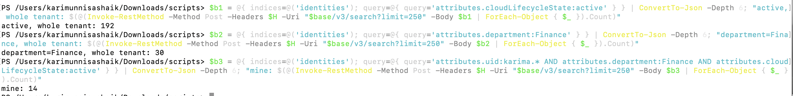

| Criteria | Would match | I intended | Over-grant |
|---|---|---|---|
| `Lifecycle State = active` | **192** | 84 | +108 |
| `Department = Finance` | **30** | 14 | +16 |

Thirty identities in this tenant carry `department = Finance`; fourteen are
mine. The criteria I was about to use would have more than doubled the role's
reach — and a birthright role grants on match, with no request and no approval
step to catch it.

I also have the same point from the other direction. Here is one of my
identities *before* I enabled anything, already holding a role somebody else
built, whose criteria reach into my population:

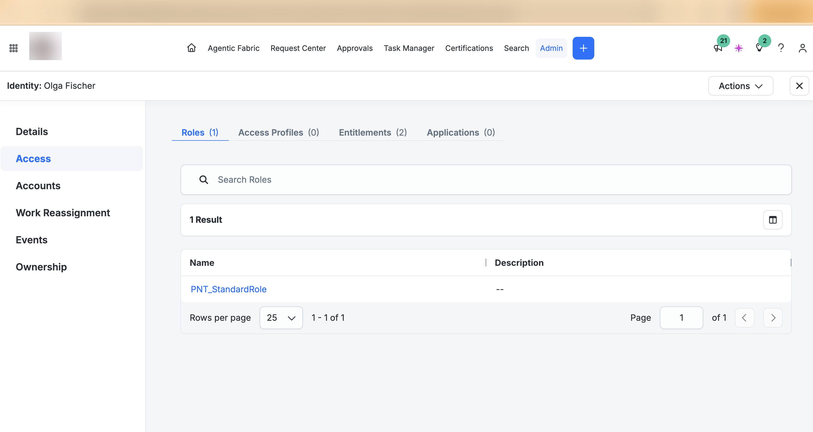

**A role's blast radius is its criteria, not its author's intent.** A shared
tenant makes that visible immediately; a dedicated tenant hides it. The mechanic
is identical in production — criteria evaluate against the whole directory — but
there the extra matches are real employees in other business units, and the
discovery arrives months later as a certification asking why so many people hold
a Finance entitlement.

---

## Two ways to fence a role

Each role is scoped, and deliberately by a different mechanism so that the
repository demonstrates both:

| Role | Fence | Why |
|---|---|---|
| `Acme - All Employees` | Username starts with this lab's prefix | Every identity here carries it; nothing else in the tenant does |
| `Finance - Team Member` | Account attribute on this lab's own HR source | Membership requires holding an account on the source I own |

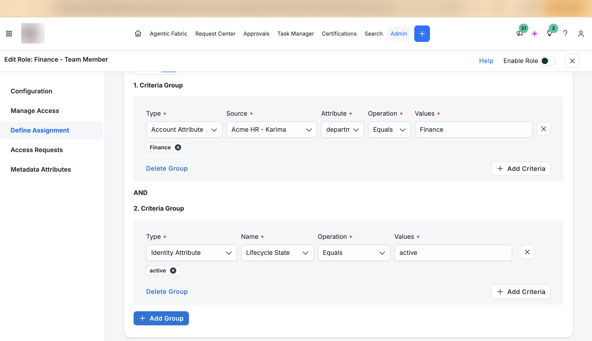

The second is the more defensible pattern in a real tenant, where you don't get
to invent a username prefix: *you are in this role because you have an account
on the authoritative source that says so.* The first is the pragmatic one when a
reliable marker exists.

Both conditions sit in a single `AND`. If they end up in separate groups joined
by `OR`, the role matches anyone in Finance **or** anyone active — which is the
192 figure, arrived at by accident.

---

## Verifying with a negative case

The count alone proves nothing: 14 could be two wrong conditions agreeing. So
the check is both directions.

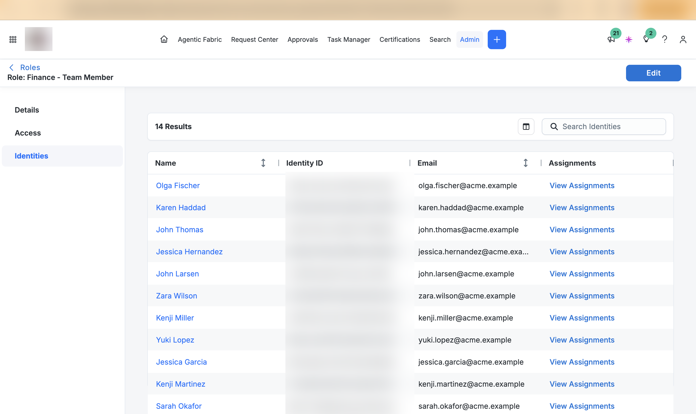

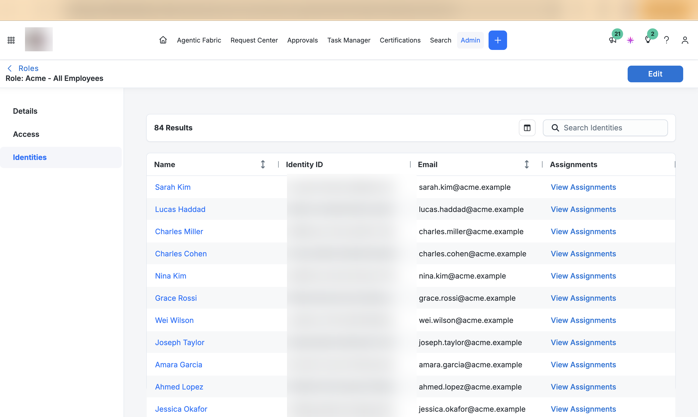

| Test | Expect | Proves |
|---|---|---|
| A Finance employee in my population | role granted | criteria match |
| An IT employee in my population | role absent | the department condition works |
| A Finance identity **not** in my population | role absent | the scope fence holds |

And on an individual identity — before, one foreign role and no access profiles;
after, the birthright roles and the access profiles they carry:

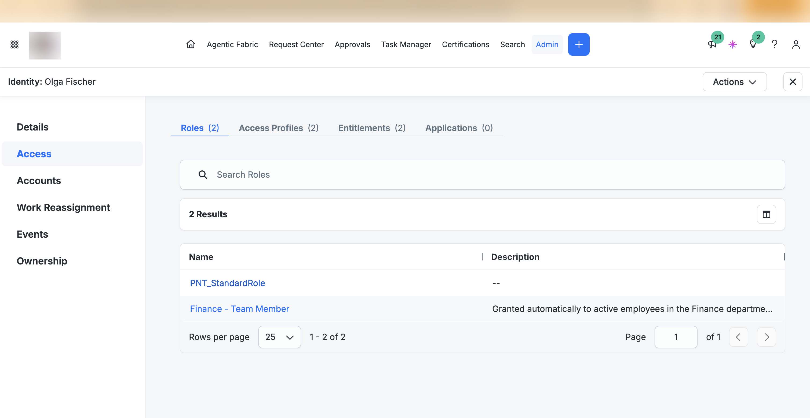

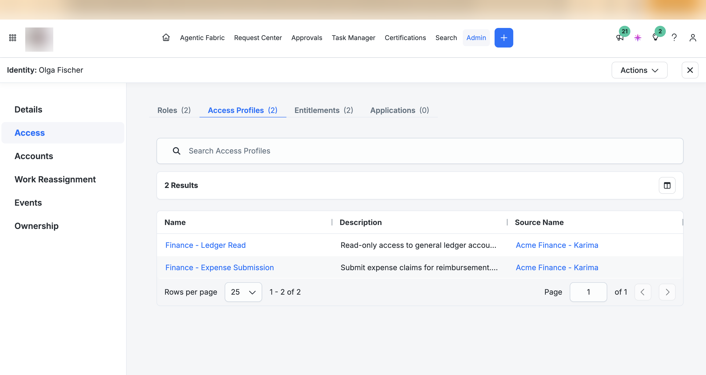

Both membership figures — 84 and 14 — were derived from the source data before
any of these objects existed, and both matched. That is the difference between
"my role has 14 members" and "my role has the right 14 members", and almost
nobody tests the second.

---

## Three things the product taught me

**A stored rule can be valid and impossible.** Mid-build the role stopped
matching anyone, with no error. Reading the object back rather than the page
showed why:

```json
{ "operation": "EQUALS",
  "key": { "type": "IDENTITY", "property": "attribute.uid" },
  "values": [ "active" ] }
```

Username equals `active`. Changing the attribute in the criteria form left the
previous value in place, and ISC stored the result — because that *is* a valid
rule, just one that can never be true. In production this is a birthright role
silently not granting day-one access while everyone assumes it is. It took five
minutes to find instead of five days because I read the object rather than the
form.

**Configuration is not state until something applies it.** Role membership is
recalculated by an identity processing queue, which runs on an aggregation that
*changed* an identity, a twice-daily job covering *only changed* identities, a
scheduled date, or a manual **Apply Changes**. Re-aggregating the source did
nothing — identical data changes no identity, so nothing was reprocessed, so the
criteria never ran. From the role page, "the role isn't working" and "the role
hasn't been evaluated yet" are indistinguishable.

**Membership is a moving target while it recalculates.** During one Apply
Changes the same query returned **14 → 12 → 0 → 10 → 13 → 14**. Nothing was
wrong at any point; I was sampling a set mid-rebuild. For a while two identities
looked like a genuine anomaly — byte-identical attributes to colleagues who did
hold the role — and they were simply late in the queue. The console gives no
indication that a recalculation is running, so the only defence is to read a
number twice and believe it when it repeats.

---

## What governance can decide and cannot do

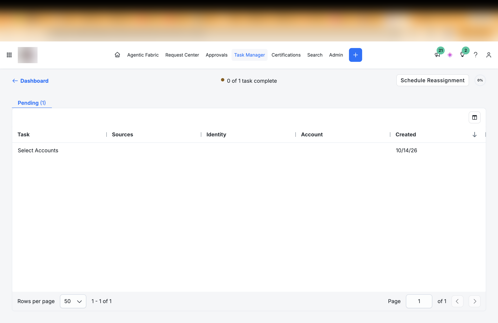

Enabling the birthright roles generated manual fulfilment items rather than
account changes. The Finance source is a flat file with no provisioning
interface, so ISC records the decision and queues the work for a human.

That is not a failure — it is the honest state of governance over any
application without an API, and most organisations have several. The decision is
made, recorded and auditable; the execution is manual. Claiming the accounts
were provisioned, when the CSV is unchanged, is the kind of overstatement that
unravels under questioning.

It is also the argument for the next integration. The same test against Entra
ends with an account genuinely disabled in a real directory.

---

## An interruption, and what made it survivable

Midway through this milestone the shared training tenant was cleaned up to get
back under its 500-identity licence cap, and my identity profile was deleted
along with the access model. That removes every identity the profile created —
94 of them — while leaving the source accounts in place, pointing at nothing.

It cost a session and changed nothing about the design. Three things made it a
rebuild rather than a restart:

**The configuration was written down.** Transform logic, schema settings, the
two identity-profile mappings that had failed silently in an earlier rebuild,
and the expected counts at every step. Recovery was mechanical and every number
was checked against a value recorded beforehand — 94 identities, 84/4/3/3
lifecycle states, 31/24/7 on Finance, 12/9/3 on Entra.

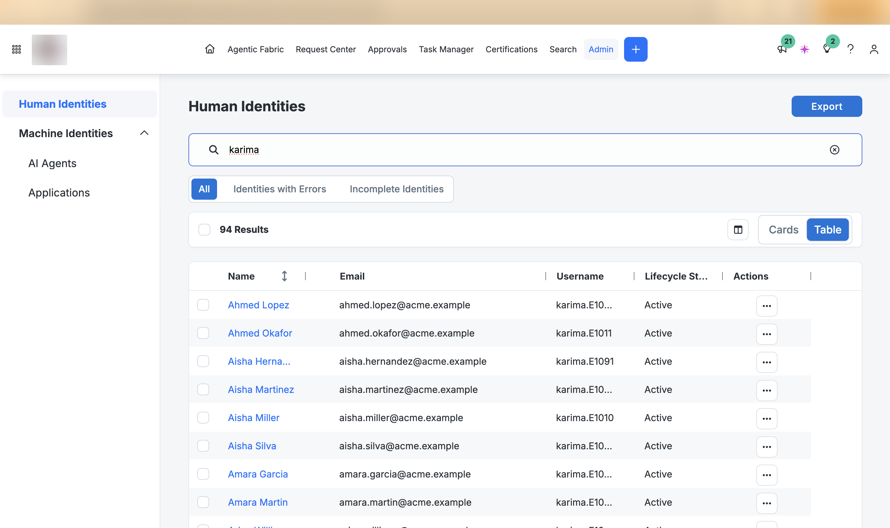

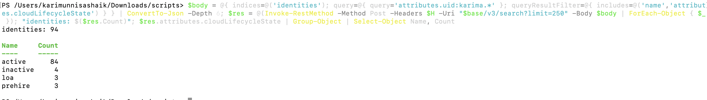

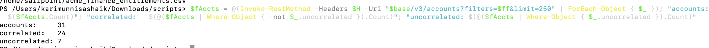

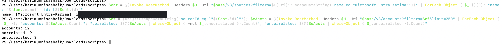

**The access model was code.** Five access profiles and two roles came back from
a definition file in seconds, with owners, descriptions, approval schemes and
scope fences intact — rather than from twenty minutes of clicking and whatever I
remembered to re-set.

**Credentials were the real lesson.** My API access died with the deletion,
because a personal access token belongs to an *identity*: remove the identity
and the token stops working, permanently — re-enabling does not restore it. The
correct construction is an API client whose credentials belong to the tenant
rather than to an employee. This is the standard argument for service accounts,
and I had read it several times without it meaning anything.

Full sequence in [the recovery runbook](identity-profile-recovery-runbook.md),
including two product behaviours worth knowing: transforms can only be created
through the API, so a broken credential blocks a rebuild entirely; and a
delimited source has two ingestion paths that validate differently, where the
appliance silently accepts a file the API refuses.

**In a shared environment you cannot prevent other people's actions, so the
answer is to make your work cheap to rebuild rather than hard to touch.** That
is the same reasoning behind infrastructure-as-code, learned here from the
wrong end.

---

## One workaround that silently broke another layer

Every identity showed `MANAGER --`, despite the identity profile mapping Manager
to an account attribute that was populated with a manager who exists in the same
population:

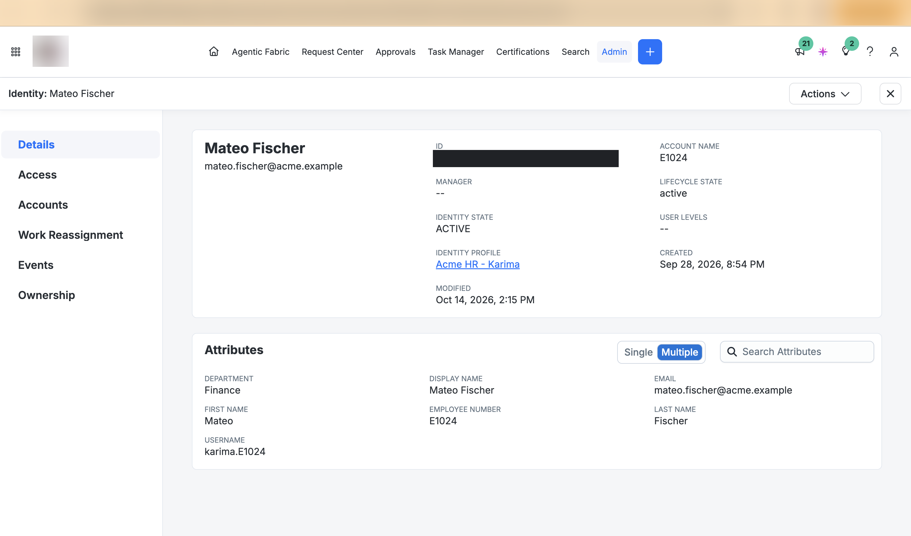

The mapping was correct. The value was wrong in a way nothing reported.

**ISC resolves a manager reference against the identity's username**, not
against the account identifier. Every identity in this lab carries a `karima.`
username prefix — a workaround for usernames being unique tenant-wide in a
shared environment, which has nothing to do with org hierarchy. So a manager key
of `E1001` matched no identity, while `karima.E1001` matches exactly one.

Carrying the prefix into the manager key fixed it:

```
no manager:      1
foreign manager: 0

Identities with no manager:
  Karen Whitfield

PASS  manager graph is sound.
```

One manager-less identity, which is the person at the top, and no references
pointing outside the population.

**This is the most realistic failure in the lab.** A fix for one constraint — 
username collisions in the identity layer — invalidated an assumption two layers
away in manager resolution, with no error anywhere. The symptom was a blank
field on a details page that nobody would look at until an access request failed
to route. Nothing in the product connects those two facts, and nothing
documented warns you.

It matters immediately for the next milestone: access requests route to the
requester's manager, and a reference that resolves to nothing leaves a request
sitting with no approver and no error.

---

## An open item

**`Test-SourceIdentityIntegrity.ps1` has a latent bug.** `Invoke-RestMethod` can
return a result array as a single object; wrapping it in `@()` then yields a
count of 1 rather than 94, and the script would report one account, one identity
and print **PASS**. Fixed by forcing unrolling in the pagination helper — but it
is exactly the class of silent wrong answer the script exists to catch.

`Test-ManagerGraph.ps1` does not have the equivalent weakness: it compares the
manager-less count to an expected root count with exact equality, so a
completely empty graph fails rather than passes. Worth stating, because I
assumed otherwise and was wrong — a check is only trustworthy if you have read
the condition, not if you remember writing it.

---

## What's next

The two requestable roles are built and deliberately not enabled yet, because
the **separation-of-duties policy** should exist first. Three people in this
data hold both `Expense_Submit` and `AP_Approver` — they can submit an expense
claim and approve its own payment. With the policy in place before the roles go
live, requesting AP Approval for somebody who already submits expenses should be
*intercepted*, and a blocked request is a far better artefact than three rows in
a violations report.

Then the leaver test, then provisioning to Entra, where a revocation changes
something real.

---

## What I would check first next time

1. **What would these criteria match across the whole tenant?** Measure before
   enabling, not after.
2. **Is the unit of access the unit of decision?** One entitlement per profile
   unless two genuinely travel together.
3. **Would the owner be able to answer a certification?** If not, the owner is
   wrong.
4. **Read the object back.** The rendered form and the stored rule are not the
   same thing, and only one of them is executed.
5. **Has anything been processed since the rule came into existence?**
6. **Read every number twice.** Five readings of one membership set gave five
   answers, and all of them were honest.
